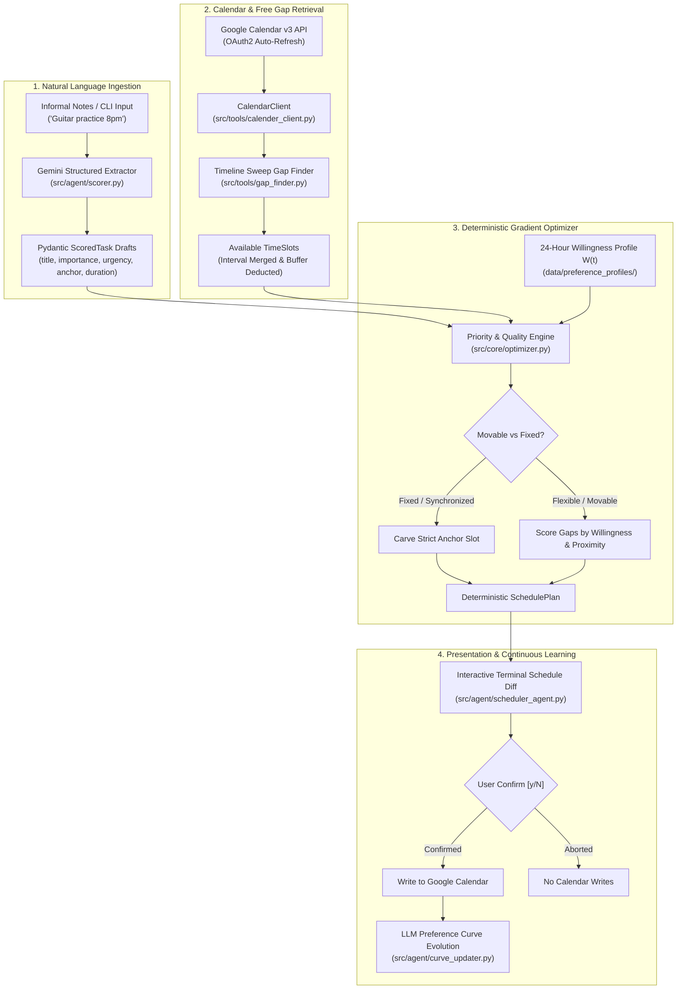

# Autonomous Calendar Scheduling Agent

[](https://www.python.org/)
[](https://ai.google.dev/)
[](https://developers.google.com/calendar)
[](https://oauth.net/2/)
[](https://github.com/astral-sh/uv)
[](https://docs.pytest.org/)

An autonomous personal executive assistant built on AI Engineering principles ([roadmap.sh/ai-engineer](https://roadmap.sh/ai-engineer)). The system ingests informal, unstructured natural language notes, parses them into schema-validated task drafts, resolves scheduling conflicts around immutable calendar blocks using deterministic gap-finding, optimizes slot placement via a continuous 24-hour willingness gradient, evolves user preferences dynamically via LLM feedback, and renders an interactive schedule diff before committing changes to Google Calendar.

---

## 1. System Architecture



---

## 2. Core Mathematical Formulations

### Multi-Dimensional Priority Scoring
Every ingested task is rated across **Importance** ($\text{imp} \in [1, 5]$) and **Urgency** ($\text{urg} \in [1, 5]$). The placement priority score $S_{\text{priority}}$ is computed deterministically:

$S_{\text{priority}} = w_1 \cdot \text{imp} + w_2 \cdot \text{urg} + w_3 \cdot (\text{imp} \times \text{urg})$

Where default weights are $w_1 = 0.40$, $w_2 = 0.40$, and $w_3 = 0.20$. Fixed unmovable commitments (e.g., lectures, synchronous meetings) receive an overriding priority boost to guarantee calendar anchoring.

### Continuous 24-Hour Willingness Gradient
Rather than enforcing brittle, binary working hours that break for irregular schedules (e.g. night routines, odd-hour study sessions), user availability is modeled as a continuous 24-hour gradient curve:

$W(t) \in [0.0, 1.0] \quad \text{for } t \in \{0, 1, \dots, 23\}$

Standard daytime hours receive higher willingness weights ($0.7 - 0.9$), while late-night hours (e.g., 3:00 AM) are assigned small non-zero weights ($0.05$) rather than being hard forbidden. If a calendar is packed, tasks gracefully spill into lower-willingness hours without throwing unplaced errors.

### Slot Placement Quality with Anchor Proximity
When fitting a movable task into an available gap $[t_{\text{start}}, t_{\text{end}}]$, candidate placement hours are scored based on willingness combined with distance from any requested time anchor:

$Q_{\text{slot}} = W[h] \cdot \left(1.0 - \min\left(1.0, \frac{\Delta t_{\text{hours}}}{12}\right)\right)$

Where:
- $W[h]$ is the willingness weight for the candidate starting hour $h$.
- $\Delta t_{\text{hours}} = |h - h_{\text{anchor}}|$ is the temporal distance from the user's preferred time.

### Continuous Preference Learning via LLM
Upon event creation, Gemini evaluates the placed event alongside the existing 24-hour curve and adjusts hourly preferences. All outputs are sanitized and clamped programmatically to prevent drift:

$W_{\text{updated}}[h] = \max(0.0, \min(1.0, W_{\text{raw}}[h]))$

---

## 3. Directory Layout

```
scheduler/
├── schedule.sh                 # One-click interactive launcher (zero code required)
├── setup.sh                    # Automated first-time setup and dependency wizard
├── pyproject.toml              # Build backend (hatchling), dependencies, and CLI entry point
├── requirements.txt            # Dependency manifest for pip users
├── data/
│   ├── daily_notes.md          # Active daily markdown scratchpad for informal notes
│   ├── preference_profiles/    # JSON stores for hourly willingness curves (W[0..23])
│   │   └── global_baseline.json
│   └── export/
│       └── response.json       # Structured fallback task fixtures
│
├── src/
│   ├── core/                   # Pure Domain Logic (Zero external network/SDK imports)
│   │   ├── models.py           # Dataclasses, Pydantic extraction schemas, enums
│   │   ├── exceptions.py       # CalendarError, CalendarAuthError hierarchy
│   │   ├── scoring.py          # Priority formula implementation
│   │   ├── optimizer.py        # Gap allocation, slot carving, willingness scoring
│   │   └── preference_engine.py# Profile loading, sanitization, and baseline updates
│   │
│   ├── tools/                  # External Adapters
│   │   ├── calender_client.py  # Google Calendar API v3 client (OAuth2 auto-refresh)
│   │   └── gap_finder.py       # Sweep-line free slot interval-merging algorithm
│   │
│   ├── agent/                  # LLM Orchestration
│   │   ├── scorer.py           # Gemini structured task extraction & scoring
│   │   ├── curve_updater.py    # LLM willingness curve evolution
│   │   ├── prompt_templates.py # Safe brace-isolated prompt builders
│   │   └── scheduler_agent.py  # AutonomousScheduler coordinator & diff formatter
│   │
│   └── interfaces/             # Presentation Layer
│       └── cli.py              # Interactive CLI with dry-run and sync confirmation
│
└── tests/
    ├── conftest.py             # Reusable pytest fixtures and eval markers
    ├── test_gap_finder.py      # Boundary clipping, overlap merging, buffer deduction
    ├── test_models.py          # Data contract integrity and schema validation
    ├── test_scoring.py         # Priority weight bounds and sorting
    ├── test_optimizer.py       # Slot carving, deadline constraints, gradient placement
    ├── test_preference_engine.py # Profile persistence and float clamping
    ├── test_curve_updater.py   # Curve evolution prompt builders and mock updates
    ├── test_scheduler_agent.py # Plan generation and diff rendering
    ├── test_cli.py             # CLI argument parsing, date flags, and execution flow
    ├── test_evals.py           # Live LLM regression benchmark test harness
    └── data/
        └── synthetic_notes_dataset.json # 16 synthetic real-world edge cases
```

---

## 4. Setup & Authentication

### Quick Setup (Recommended for Everyone)
Run the automated setup wizard to verify Python, install dependencies via `uv`, and validate your credentials:
```bash
./setup.sh
```
The script runs 5 automated checks and guides you through setting up `credentials.json` and `gemini_api_key.txt` if they are missing.

### Manual Setup (Advanced)

#### Prerequisites
- Python 3.11+
- [uv](https://github.com/astral-sh/uv) (recommended) or `pip`

#### Step 1: Install Dependencies
```bash
# Using uv (fastest)
uv sync --extra dev

# Or using pip
pip install -r requirements.txt
```

#### Step 2: Configure Google Calendar OAuth 2.0
1. Create a project in the [Google Cloud Console](https://console.cloud.google.com/).
2. Enable the **Google Calendar API**.
3. Configure the **OAuth Consent Screen** (add scopes: `https://www.googleapis.com/auth/calendar.events` and `https://www.googleapis.com/auth/calendar.readonly`).
4. Create **OAuth 2.0 Client IDs** (Application type: *Desktop application*).
5. Download the credentials JSON file and save it in the repository root as `credentials.json`.
6. On first execution, the client prompts your browser for one-time OAuth consent and caches the credentials in `token.json` with automatic token refresh.

#### Step 3: Configure Gemini API Key
Provide your Gemini API key through either:
```bash
# Option A: Plaintext file in project root (easiest)
echo "your-api-key-here" > gemini_api_key.txt

# Option B: Environment variable
export GEMINI_API_KEY="your-api-key-here"
```

---

## 5. Usage & Workflows

### Guided Interactive Mode (Zero Code Required)
The simplest way to use the scheduler is via the interactive launcher:
```bash
./schedule.sh
```
This launches a guided terminal wizard that:
1. Prompts you to enter tasks in plain English (one per line).
2. Asks which day to schedule (Today, Tomorrow, or Pick a date).
3. Asks whether to use standard hours (09:00 – 21:00) or custom hours.
4. Generates an optimal conflict-free schedule preview.
5. Asks for confirmation before adding events to your Google Calendar.

### Quick Command-Line Scheduling
Schedule a task directly from your terminal:
```bash
# Preview placement without touching your calendar (Dry Run)
./schedule.sh "Guitar practice 8pm" --dry-run

# Commit and sync to Google Calendar with interactive confirmation [y/N]
./schedule.sh "Guitar practice 8pm" --sync
```

### Daily Notes Scratchpad Scheduling
Write multi-line informal tasks into `data/daily_notes.md`:
```markdown
- [ ] Review PR architecture 45m by 3pm
- [ ] Team sync with Rohan 30m at 4pm
- [ ] Complete calculus assignment 2 hours
```
Execute the scheduler to ingest `data/daily_notes.md` automatically:
```bash
./schedule.sh --sync
```

### Scheduling for Tomorrow or Specific Dates
```bash
# Schedule tasks for tomorrow
./schedule.sh "Gym workout 7am" --tomorrow --dry-run

# Schedule tasks for a specific calendar date
./schedule.sh "Dentist appointment 11am" --date 2026-11-15 --sync
```

### CLI Options Reference
| Flag | Description | Default |
|---|---|---|
| `note_words` | Direct note string directly on command line | None |
| `--interactive` | Launch the guided terminal wizard | Auto-detected |
| `-n, --notes PATH` | Path to markdown file, text file, or response.json | `data/daily_notes.md` |
| `--raw-text TEXT` | Raw unstructured notes string | None |
| `--date YYYY-MM-DD` | Target date for schedule planning | Today |
| `--tomorrow` | Target tomorrow's calendar window | False |
| `--start-hour INT` | Daily start hour in 24h format | `9` (09:00) |
| `--end-hour INT` | Daily end hour in 24h format | `21` (21:00) |
| `--buffer INT` | Buffer minutes between placed tasks | `5` |
| `--dry-run` | Offline preview mode; skips live calendar fetch | False |
| `--sync` | Prompts for human `[y/N]` confirmation to sync | False |

---

## 6. Testing & Evaluation Benchmark

### 1. Deterministic Unit Tests (Offline)
47 offline unit tests verify domain data contracts, interval merging, slot carving, willingness gradient selection, and CLI parsing in under 2 seconds:
```bash
uv run --extra dev pytest -m "not evals" -v
```

### 2. Live LLM Regression Evaluation Benchmark
A dedicated benchmark suite evaluates Gemini's extraction accuracy against 16 synthetic real-world edge cases ([`tests/data/synthetic_notes_dataset.json`](tests/data/synthetic_notes_dataset.json)):
```bash
uv run --extra dev pytest -s tests/test_evals.py
```

Benchmark targets and verified accuracy:
| Metric | Benchmark Target | Measured Accuracy |
|---|---|---|
| **Event Type Classification** | $\ge 80.0\%$ | **93.8%** |
| **Mobility Classification (`is_movable`)** | $\ge 80.0\%$ | **100.0%** |
| **Duration Calibration** | $\ge 80.0\%$ | **100.0%** |
| **Start Hour Anchor Extraction** | $\ge 80.0\%$ | **100.0%** |

---

## 7. Security & Credentials
- All secrets (`credentials.json`, `token.json`, `gemini_api_key.txt`, `data/clientJson/`) are explicitly excluded via `.gitignore`.
- Domain modules under `src/core/` are isolated from external networks to ensure testability and prevent unintended side effects.
